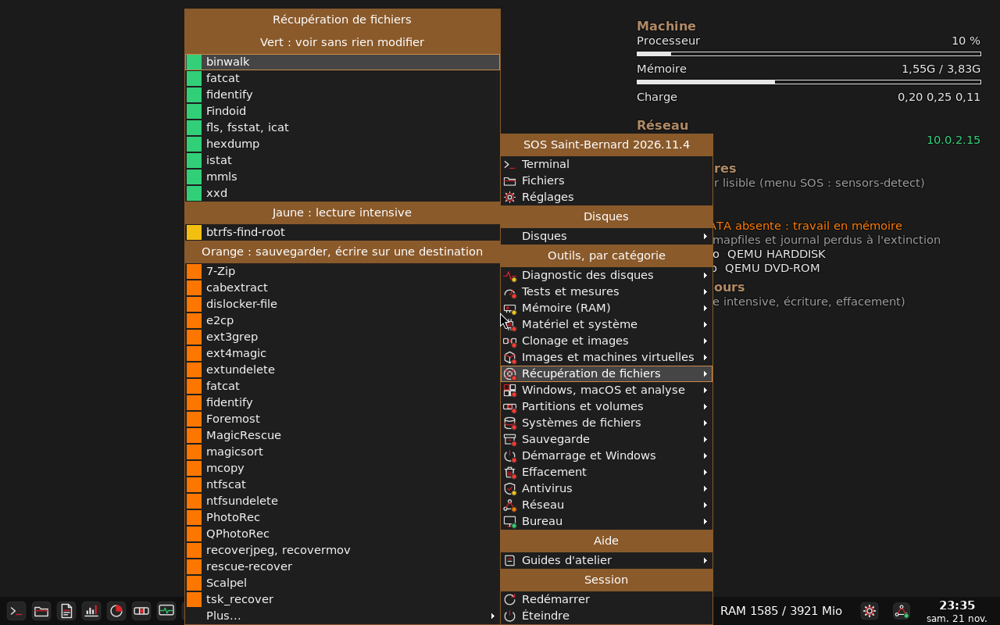

  

<h1 align="center">Saint-Bernard</h1>

<a href="README.md">Français</a> · <b>English</b>

  <b>The rescue system that comes to fetch your data.</b> 
  A USB key that boots any PC, protects its disks and brings together more than 300 diagnostic, cloning and recovery tools, sorted by risk.

  <a href="../../releases/latest"><b>Download the ISO</b></a> ·
  <a href="https://github.com/TheWorms/sb-imager"><b>SB Imager</b> (create the key)</a> ·
  <a href="../../wiki/Overview">Documentation (wiki)</a> ·
  <a href="../../wiki/Tools">Tools</a> ·
  <a href="../../wiki/Practical-sheets">Practical sheets</a>

## In short

- **Disks are protected**: everything is read-only at boot; only the destination is unlocked, on purpose.
- **More than 300 tools** in 16 categories, each with its **risk colour**, from green (reading) to red (modifies or destroys).
- **Graphical assistants** for 300 of them, and **104 step-by-step practical sheets**.
- **The key is made with [SB Imager](https://github.com/TheWorms/sb-imager)**, Raspberry Pi Imager style: it downloads the ISO, checks it, writes it and reads the key back.
- **Boots everywhere**: BIOS, UEFI, UEFI with Secure Boot; in French or English.
- Based on **Debian 13 (trixie)**, 64-bit. 1.1 GB image.

## Documentation

Everything is in the **[wiki](../../wiki/Overview)**, page by page: [download](../../wiki/Download), [create the USB key](../../wiki/Create-the-USB-key), [booting](../../wiki/Booting), [the desktop](../../wiki/The-desktop), [the recovery method](../../wiki/Recovery-method), [the tools](../../wiki/Tools) and [the practical sheets](../../wiki/Practical-sheets).

## Licence

This repository and its wiki (texts, sheets, screenshots, logo) are published under the **GPL-3.0-or-later** licence: see [LICENSE](LICENSE). The software contained in the ISO keeps its own licence, that of its Debian package (package list attached to each Release).
