<p align="center">
  
</p>

<h1 align="center">Saint-Bernard</h1>

<p align="center">
  <b>Le système de secours qui vient chercher vos données.</b><br>
  Une clé USB qui démarre n'importe quel PC, protège ses disques et rassemble plus de 300 outils de diagnostic, de clonage et de récupération, rangés par risque.
</p>

<p align="center">
  <a href="../../releases/latest"><b>Télécharger l'ISO</b></a> ·
  <a href="OUTILS.md">Tous les outils</a> ·
  <a href="fiches/README.md">Fiches pratiques</a> ·
  <a href="#créer-la-clé-usb">Créer la clé</a>
</p>

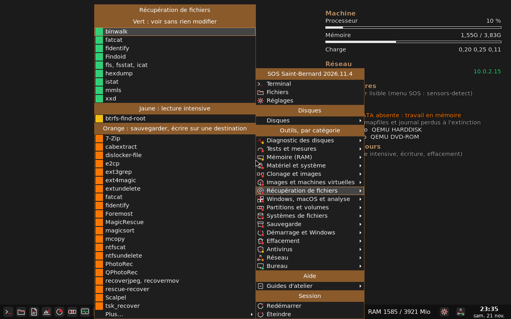

## En bref

- **Les disques sont protégés.** Au démarrage, tous les disques de la machine sont en lecture seule : rien ne s'y écrit par accident, pas même un journal de système de fichiers. On déverrouille exprès le seul disque de destination (`rescue-rw`).
- **Chaque outil a sa couleur de risque**, du vert (lecture des informations) au rouge (modifie ou détruit), dans le menu comme dans les fiches.
- **Plus de 300 outils** en 16 rubriques : diagnostic SMART, clonage de disques défaillants (GNU ddrescue), récupération de fichiers (PhotoRec, TestDisk), partitions, RAID, LVM, chiffrement, Windows et macOS, mémoire, réseau, effacement sûr. [La liste complète](OUTILS.md).
- **Des assistants graphiques** pour 300 d'entre eux : une fenêtre pose les questions dans l'ordre, montre la commande, puis la lance.
- **Des fiches pratiques** pour les outils essentiels : usages pas à pas, commandes prêtes à copier, pièges à éviter. [Les 104 fiches](fiches/README.md).
- **Démarre partout** : BIOS ancien, UEFI, UEFI avec Secure Boot. Le système se charge en mémoire si la machine a au moins 3 Go : on peut alors retirer la clé.
- **En français ou en anglais**, au choix dans le menu de démarrage.
- Basé sur **Debian 13 (trixie)**, 64 bits (amd64). Image de 1,1 Go.

## Captures

<table>
<tr>
<td width="50%">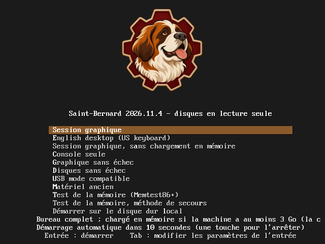<br><sub><b>Menu de démarrage.</b> Session graphique par défaut, en anglais, console seule, modes sans échec, matériel ancien, test de la mémoire.</sub></td>
<td width="50%">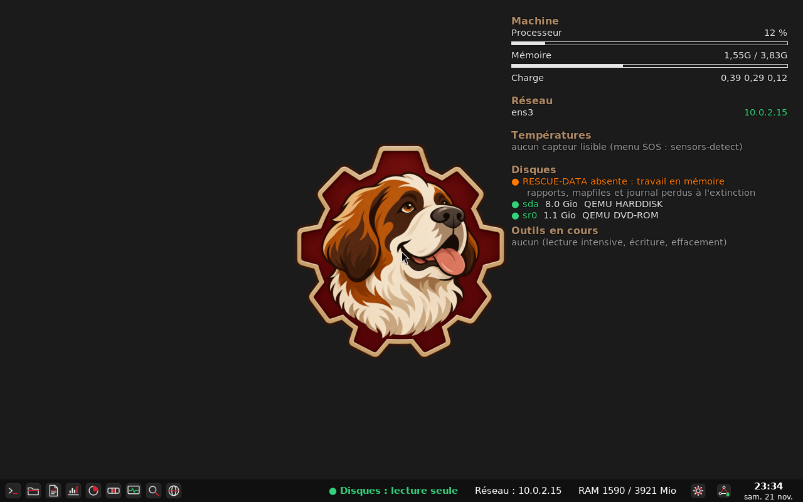<br><sub><b>Le bureau.</b> À droite, le suivi de la machine : processeur, mémoire, réseau, températures, disques. En bas, l'état de protection des disques.</sub></td>
</tr>
<tr>
<td>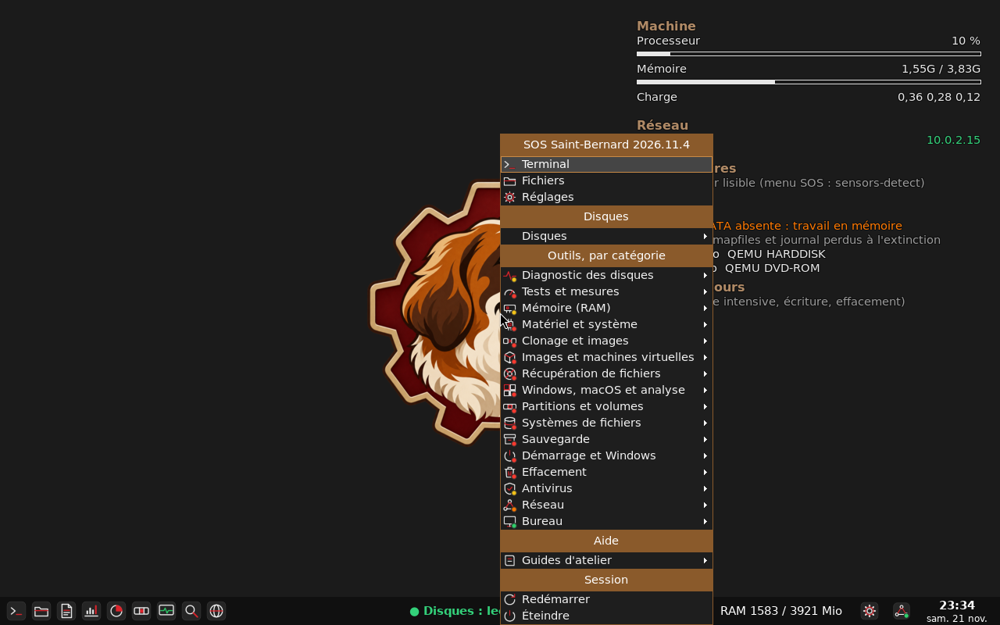<br><sub><b>Le menu SOS</b> (clic droit sur le bureau, ou Super+Maj+D) : les outils par rubrique.</sub></td>
<td>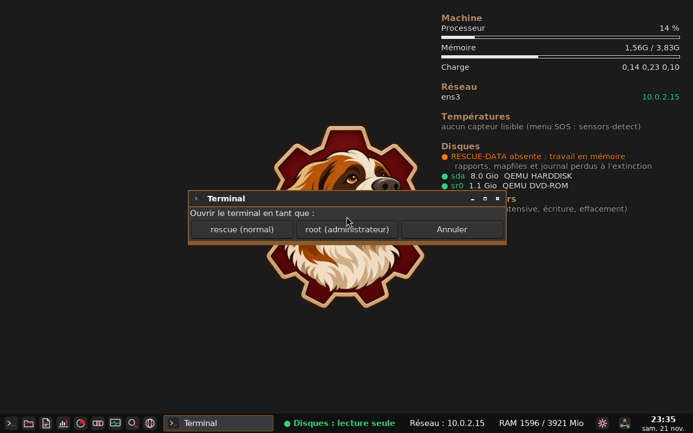<br><sub><b>Terminal</b> (Super+Entrée) : utilisateur ou administrateur, au choix à l'ouverture.</sub></td>
</tr>
<tr>
<td>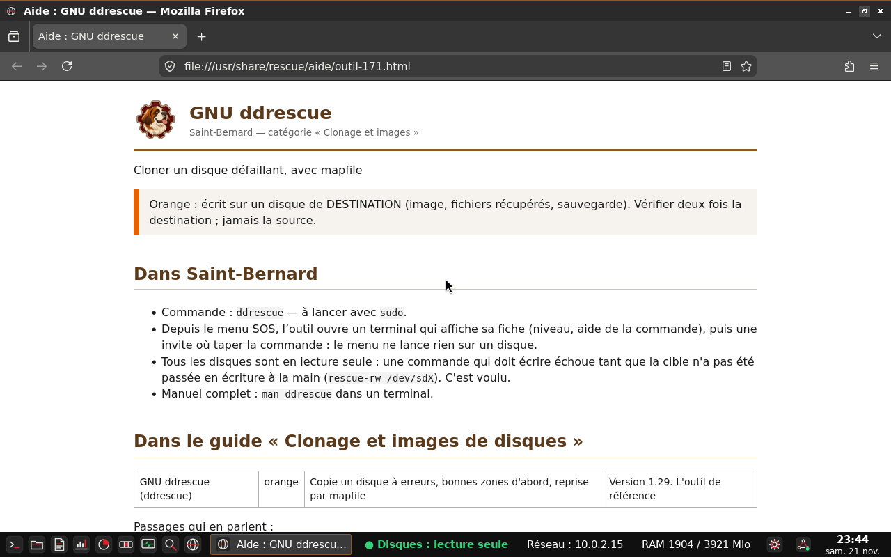<br><sub><b>La page d'aide</b> s'ouvre avec l'outil, si on le souhaite : usages pas à pas, commandes, pièges.</sub></td>
<td>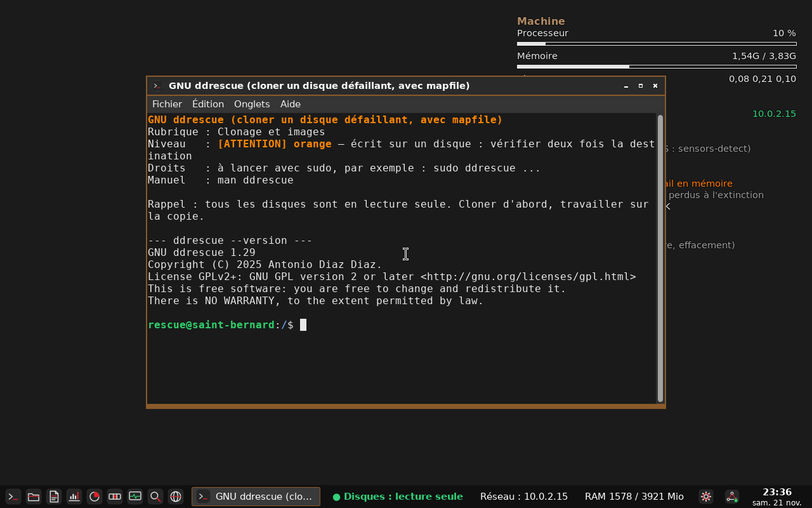<br><sub><b>Un outil en ligne de commande</b> s'ouvre dans un terminal : sa couleur de risque et son aide au-dessus de l'invite.</sub></td>
</tr>
<tr>
<td>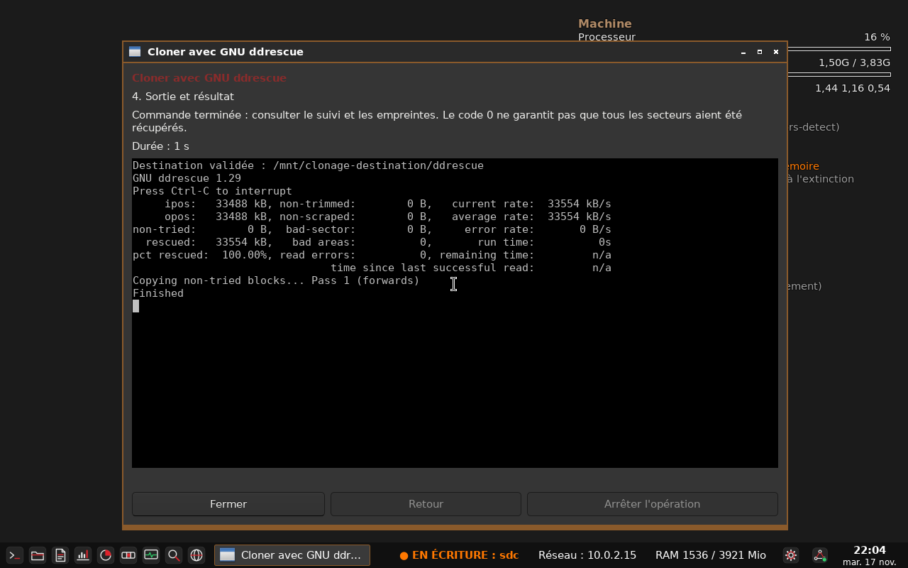<br><sub><b>Assistant ddrescue</b> : la copie terminée, la sortie de l'outil et sa durée.</sub></td>
<td>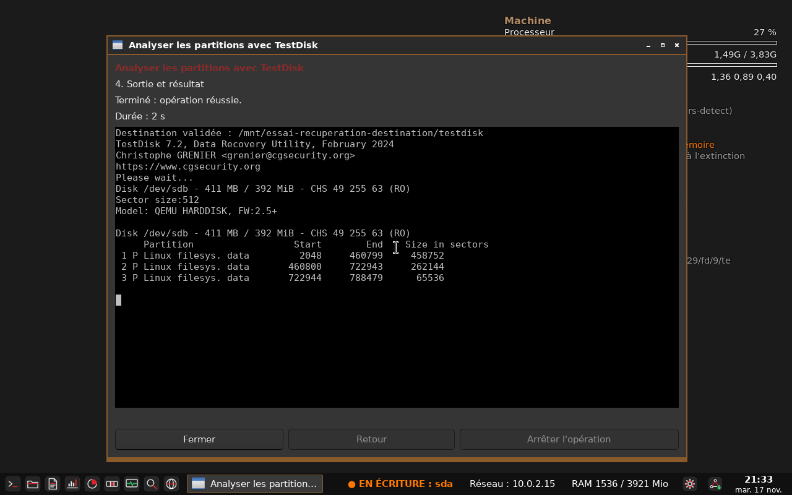<br><sub><b>Assistant TestDisk</b> : les partitions trouvées sur le disque.</sub></td>
</tr>
<tr>
<td>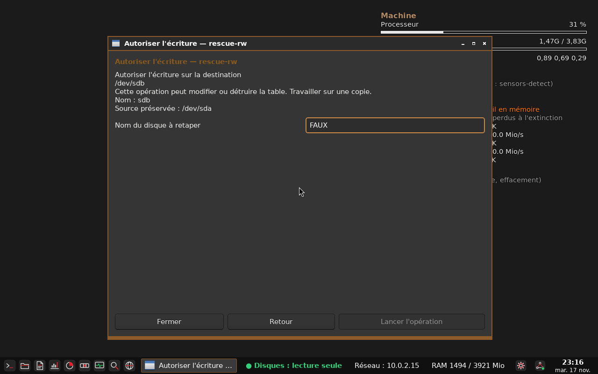<br><sub><b>Écrire sur un disque</b> se demande exprès : on retape son nom (<code>rescue-rw</code>).</sub></td>
<td>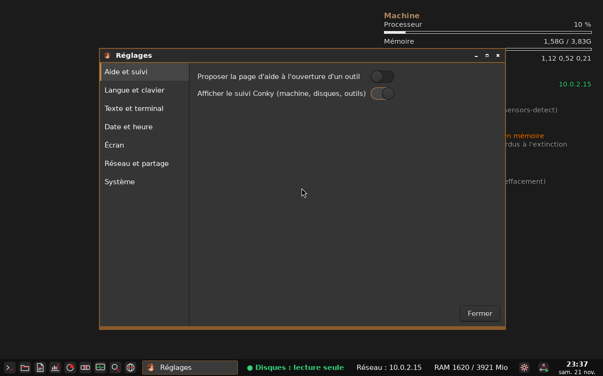<br><sub><b>Réglages</b> : aide à l'ouverture des outils, suivi, clavier, date et heure, écran, réseau.</sub></td>
</tr>
</table>

## Télécharger

La dernière version est dans les [Releases](../../releases/latest) :

| Fichier | Contenu |
|---|---|
| `saint-bernard-VERSION-COMMIT-amd64.iso` | l'image (1,1 Go) |
| `….iso.sha256` | son empreinte SHA-256 |
| `….packages` | la liste des paquets Debian de l'image |

Vérifier l'image après le téléchargement :

```bash
sha256sum -c saint-bernard-2026.11.4-068f6eb-amd64.iso.sha256
```

## Créer la clé USB

Une clé de **2 Go au moins**. Elle sera entièrement effacée.

**SB Imager**, l'utilitaire de création de clé, sur le modèle de Raspberry Pi Imager : choisir la version (téléchargée et vérifiée), choisir la clé, écrire. Il ne propose jamais le disque du système, demande confirmation avant d'effacer la clé, relit la clé octet par octet après l'écriture et ajoute la partition de données RESCUE-DATA. Pour Linux ; Windows ensuite. *Publication à venir, dans son propre dépôt.*

**En attendant**, tout outil qui écrit l'image telle quelle convient (Rufus en mode « image DD », balenaEtcher, `dd`) : la clé démarre, seule la partition RESCUE-DATA manque.

## La partition RESCUE-DATA

Après l'image, le reste de la clé devient une partition ext4 nommée RESCUE-DATA. Saint-Bernard y range ce qui doit survivre à l'arrêt :

| Dossier | Contenu |
|---|---|
| `logs/` | journaux des interventions |
| `reports/` | rapports d'intervention (`rescue-report`, en HTML) |
| `mapfiles/` | cartes de reprise de GNU ddrescue : un clonage interrompu reprend où il s'était arrêté |
| `clamav-db/` | base de signatures de l'antivirus, mise à jour une fois pour toutes |
| `hwinfo/` | inventaires matériels |
| `scripts-perso/`, `config/` | vos scripts et vos réglages |

## Démarrer

Brancher la clé, puis choisir le démarrage sur USB (souvent F12, F11, F8 ou Échap à l'allumage). Le menu part seul au bout de 10 secondes sur la session graphique.

| Entrée | Quand la choisir |
|---|---|
| Session graphique | le cas courant ; chargée en mémoire si la machine a au moins 3 Go |
| English desktop (US keyboard) | session en anglais, clavier américain |
| Session graphique, sans chargement en mémoire | peu de mémoire, ou clé à garder branchée |
| Console seule | pas d'affichage graphique, ou travail en texte |
| Graphique sans échec | écran noir ou figé avec la session normale |
| Disques sans échec | contrôleur de disques capricieux |
| USB mode compatible | clé ou port USB récalcitrant |
| Matériel ancien | vieux PC |
| Test de la mémoire (Memtest86+) | plantages au hasard : tester la mémoire vive |
| Démarrer sur le disque dur local | repartir sur le système installé |

## Méthode

Saint-Bernard est construit autour d'une méthode prudente, rappelée dans le menu (**Procédure type de récupération**) :

1. **Ne rien écrire** sur le disque à secourir. Il est protégé dès le démarrage.
2. **Lire son état** : `rescue-disks`, `rescue-smart`. Un disque qui faiblit se lit une seule fois, et de préférence en entier.
3. **Le cloner** vers un disque sain avec GNU ddrescue ([fiche](fiches/ddrescue.md)), carte de reprise sur RESCUE-DATA.
4. **Travailler sur la copie** : réparer, récupérer ([PhotoRec](fiches/photorec.md), [TestDisk](fiches/testdisk.md)), analyser.
5. **Garder une trace** : `rescue-report` écrit un rapport d'intervention.

<p align="center">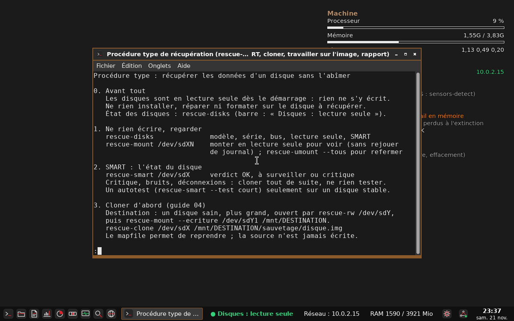<br><sub><b>Procédure type</b>, dans le menu SOS, rubrique Bureau.</sub></p>

## Les outils

| Rubrique | Exemples |
|---|---|
| Diagnostic des disques | état des disques, SMART, `rescue-disks`, `rescue-report` |
| Tests et mesures | surface, débit, `badblocks`, `fio` |
| Mémoire (RAM) | Memtest86+, `memtester` |
| Matériel et système | inventaire, capteurs, `lshw`, `dmidecode` |
| Clonage et images | GNU ddrescue, Clonezilla, `dd`, `dc3dd`, images EWF et AFF |
| Images et machines virtuelles | VMDK, VHD(X), QCOW2 : ouvrir en lecture seule, convertir |
| Récupération de fichiers | PhotoRec, TestDisk, `foremost`, `fls` |
| Partitions et volumes | GParted, `fdisk`, `cfdisk`, RAID, LVM, LUKS, BitLocker, ZFS |
| Systèmes de fichiers | contrôle et réparation : ext4, NTFS, Btrfs, XFS, FAT, HFS+… ; APFS en lecture |
| Démarrage et Windows | GRUB, EFI, `rescue-chroot`, registre et mots de passe Windows (`hivexsh`, `chntpw`) |
| Windows, macOS et analyse | Autopsy, chronologies (Plaso), clichés VSS, NTFS et APFS en lecture seule |
| Sauvegarde | `borg`, `restic`, `rsync`, partclone |
| Effacement | `rescue-wipe` (effacement puis relecture complète), `nwipe`, `shred`, `wipefs` |
| Réseau | Wi-Fi, partage Samba, `ssh`, `rsync`, navigateur web |
| Antivirus | ClamAV |
| Bureau | terminal, fichiers, éditeur, `tmux`, `mc`, réglages |

**[La liste complète des outils →](OUTILS.md)**, avec leur couleur de risque, leur façon de s'ouvrir et leur fiche.

## Versions

| Version | Nouveautés |
|---|---|
| [2026.11.4](versions/2026.11.4.md) | fiches pratiques des 81 outils essentiels ; outils administrateur lancés depuis le terminal ; `rescue-chroot` ; Wi-Fi des PC courants ; adresse IP dans le suivi |

Chaque version est validée dans des machines virtuelles (démarrages BIOS, UEFI et UEFI Secure Boot ; bancs d'essai des outils et des assistants) avant d'être publiée. Les essais sur du vrai matériel continuent.

## Sources

Saint-Bernard est construit avec [live-build](https://salsa.debian.org/live-team/live-build) à partir des paquets officiels de Debian 13 (sections main, contrib, non-free et non-free-firmware). Le code source de chaque paquet est disponible chez Debian ([sources.debian.org](https://sources.debian.org), [snapshot.debian.org](https://snapshot.debian.org) pour une version exacte). La liste des paquets de chaque image est jointe à sa Release.
